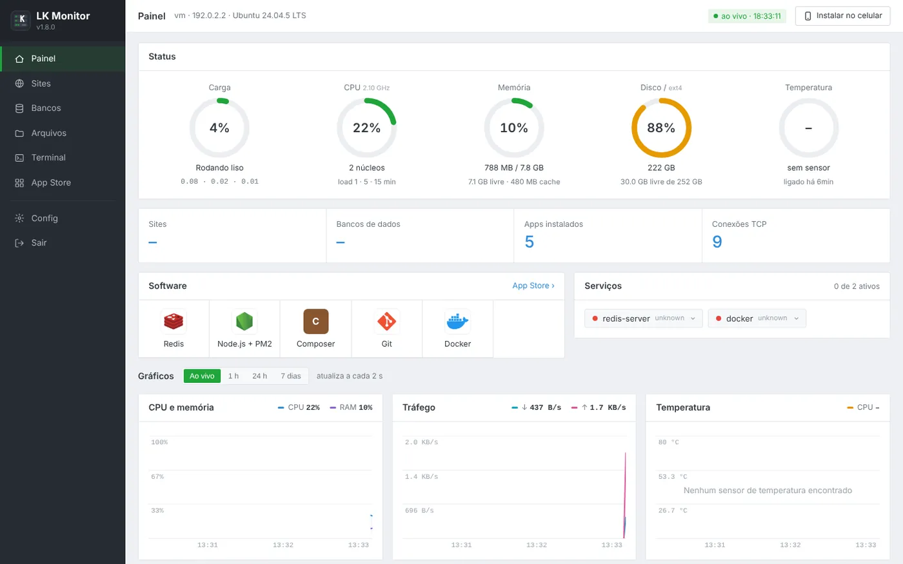
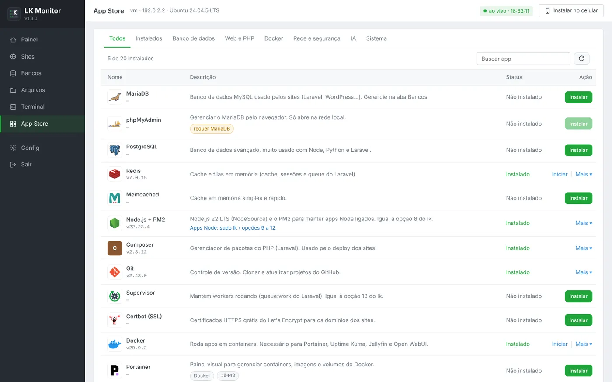
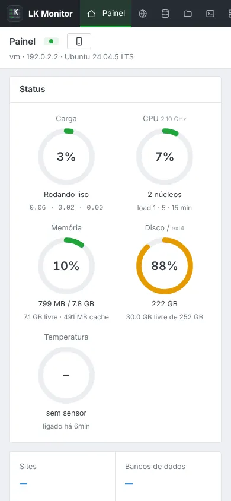

# LkPanel

**English** · [Português](README.pt-BR.md)

A free, aaPanel-style control panel that turns an old PC or laptop into a real server.
It manages websites, databases, files and services, and gives you a web terminal, an app store, a WhatsApp bot and access from anywhere.
It also ships the `lk` command, a full menu-driven tool for the terminal.

**Website:** [lkpanel.goodbits.tech](https://lkpanel.goodbits.tech/) · **Version:** 2.3.0 · **Systems:** Ubuntu 22.04 / 24.04 / 26.04 · Debian 12

> The panel interface is in Portuguese.



<p align="center"> </p>

---

## Install

On the server, as root (or with `sudo`):

```bash
curl -fsSL https://raw.githubusercontent.com/ratinhogauchonoob-arch/lkpanel/main/install.sh -o install.sh && sudo bash install.sh
```

1. Press **Enter** at "Instalar o painel agora?" ("Install the panel now?"). It installs Apache, PHP, MariaDB, SSH and the panel without asking any questions.
2. At the end it prints the address (`http://SERVER-IP:8088`), the user **`root`** and a **temporary password**.
3. On first login the panel asks you for a new password. You can use it for the Linux root account as well, which also enables root login over SSH.

After that, the terminal menu is `sudo lk`. To keep the server on a fixed IP (e.g. `192.168.0.200`): `sudo lk ip-fixo on`.

### Update
Run the new `install.sh`. It detects the existing panel and only updates it, keeping the port, password, sites, databases and data.

### Uninstall
```bash
sudo bash /usr/local/share/lk/install-lk-monitor.sh uninstall   # panel
sudo bash install.sh uninstall                                  # lk command
```

---

## Features

| Area | What it does |
|---|---|
| **Dashboard** | Live CPU, memory, disk, temperature and network, with 7-day charts. Services, processes, server mode, restart and shutdown |
| **Sites** | Create sites, turn them on and off, deploy Laravel apps, back up and restore, SSL (Let's Encrypt), logs |
| **Databases** | MariaDB and SQLite: databases, users, passwords and queries |
| **Files** | Full file manager with a code editor, upload, zip and permissions |
| **Terminal** | Full web terminal (xterm.js) with tabs |
| **App Store** | 22 one-click apps: Docker, Portainer, Jellyfin, Ollama, Open WebUI, PostgreSQL, Redis, Node + PM2, Tailscale, Cloudflare Tunnel, Fail2ban, WhatsApp + Bot and more |
| **Internet** | Cloudflare Tunnel, quick public URL (trycloudflare), password change, 2FA, login history |
| **Security** | Username + password login, 2FA (TOTP), IP lockout after 5 wrong passwords, alerts on WhatsApp and Telegram |
| **`lk`** | A 38-option menu: LAMP, sites, SSL, databases, firewall, IP blocking, PM2, Supervisor, SSH, server mode, bot |

### Remote access without opening ports
- **Tailscale**: reach the panel from anywhere, only from your own devices (available in the App Store).
- **Tailscale Funnel**: a fixed public `https://` address to share a site with anyone.
- **Cloudflare Tunnel**: use your own domain with HTTPS. Also works behind CGNAT.

---

## Requirements

| | |
|---|---|
| System | Ubuntu 22.04, 24.04 or 26.04 · Debian 12 |
| Memory | 2 GB (4 GB or more for Docker and AI apps) |
| Disk | 20 GB free |
| Access | root or a user with sudo |
| Internet | to download packages during installation |

---

## Source code

```
lkpanel/
├── install.sh                  ready-to-use installer (built by build.sh)
├── build.sh / build.py         build dist/install-lk.sh, dist/atualizar-lk.sh and dist/install-whatsapp.sh
├── CLAUDE.md                   technical notes for each version (Portuguese)
├── lk/                         the lk command (header.sh, lk, middle.sh, footer.sh)
├── lkmon/
│   ├── install-lk-monitor.sh   panel installer (@@FILE / @@BASE64 / @@DIR directives)
│   ├── www/                    goes to /var/www/lkmonitor (index.php, JS, CSS, icons)
│   └── lib/                    goes to /usr/local/lib/lkmonitor (helpers that run as root)
└── whatsapp/                   WhatsApp (GOWA), QR code page and the Guardião bot
```

### Build the installer
You need `bash`, `php` (CLI) and `python3`.
```bash
./build.sh                       # checks the syntax of everything and builds the dist/ folder
cp dist/install-lk.sh install.sh # to publish the new version
```

---

## Changelog

| Version | Changes |
|---|---|
| **2.3.0** | Fixed IP on the home network: `lk ip-fixo on` (or `sudo lk` › 38) keeps the server on the same IP, starting at .200 and skipping addresses already in use |
| **2.2.3** | `lk sites` and option 36 flag sites whose folder is missing; enabling one now warns it will return 404 |
| **2.2.2** | Websites behind Tailscale Funnel / Cloudflare Tunnel now load their CSS and JS (no more "Mixed Content"): Apache tells PHP the connection is HTTPS (`lk proxy-https`) |
| **2.2.1** | Apache and Tailscale Funnel now share port 443 without taking the panel down (`lk apache-443`) |
| **2.2.0** | No-questions install (`lk setup`). Temporary password replaced on first login, optionally applied to root with SSH root login enabled. Username on the login page. WhatsApp + Bot built into LK and in the App Store. `lk` menu in numeric order |
| **2.1.0** | Two-factor login (TOTP) and recovery codes |
| **2.0.x** | Internet tab (Cloudflare Tunnel), wrong-password lockout, login history, real client IP behind proxies |
| **1.9.0** | Classic aaPanel-style look |
| **1.8.0** | App Store |
| **1.7.0** | Buttons for services, processes, server mode and power |

---

## Security notice

The panel includes a root terminal. Use a strong password and turn on 2FA. Ideally, reach the panel through Tailscale and only publish your websites to the internet.

Made with 🐱 by Megan.
