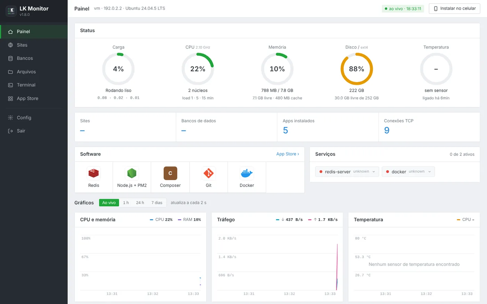
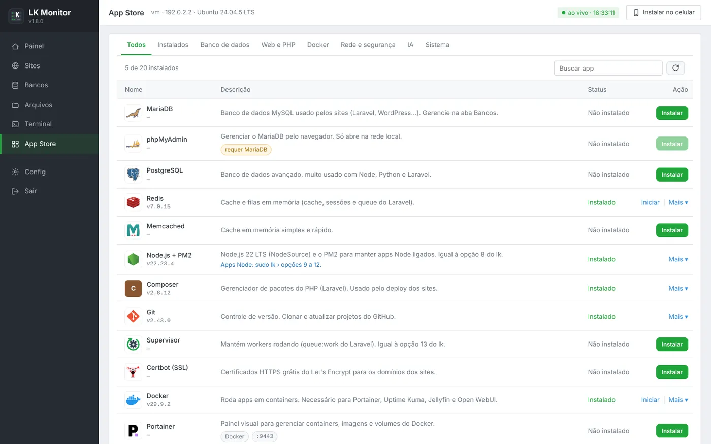
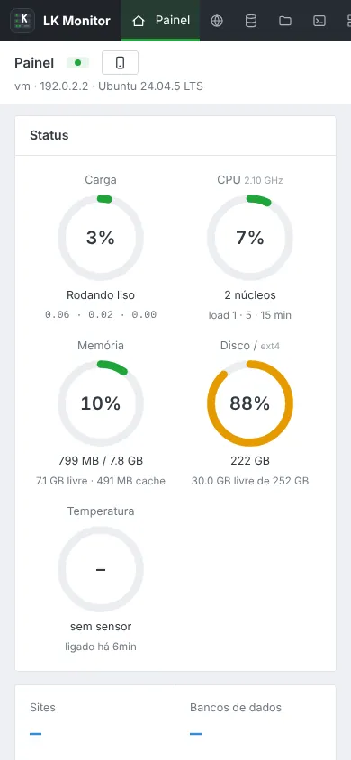

# LkPanel

**Português** · [English](README.md)

Painel grátis, estilo aaPanel, para transformar um PC ou notebook velho num servidor de verdade.
Tem sites, bancos de dados, arquivos, terminal no navegador, App Store, bot do WhatsApp e acesso de qualquer lugar.
Também traz o comando `lk`, um menu completo no terminal.

**Site:** [lkpanel.goodbits.tech](https://lkpanel.goodbits.tech/) · **Versão:** 2.3.0 · **Sistemas:** Ubuntu 22.04 / 24.04 / 26.04 · Debian 12

> A interface do painel é em português.



<p align="center"> </p>

---

## Instalar

No servidor, como root (ou com `sudo`):

```bash
curl -fsSL https://raw.githubusercontent.com/ratinhogauchonoob-arch/lkpanel/main/install.sh -o install.sh && sudo bash install.sh
```

1. Aperte **Enter** em "Instalar o painel agora?". Ele instala sozinho, sem fazer perguntas: Apache, PHP, MariaDB, SSH e o painel.
2. No final aparecem o endereço (`http://IP-DO-SERVIDOR:8088`), o usuário **`root`** e uma **senha temporária**.
3. No 1º login, o painel pede uma senha nova. Ela pode valer também para o root do Linux, com o SSH do root ligado.

Depois disso, o menu no terminal é o `sudo lk`. Para deixar o servidor num IP fixo (ex.: `192.168.0.200`): `sudo lk ip-fixo on`.

### Atualizar
Rode o `install.sh` novo. Ele detecta o painel instalado e só atualiza, mantendo porta, senha, sites, bancos e dados.

### Remover
```bash
sudo bash /usr/local/share/lk/install-lk-monitor.sh uninstall   # painel
sudo bash install.sh uninstall                                  # comando lk
```

---

## O que tem

| Parte | O que faz |
|---|---|
| **Painel** | CPU, memória, disco, temperatura e rede ao vivo, com gráficos de 7 dias. Serviços, processos, modo servidor, reiniciar e desligar |
| **Sites** | Criar, ligar e desligar, deploy Laravel, backups com restauração, SSL (Let's Encrypt), logs |
| **Bancos** | MariaDB e SQLite: bancos, usuários, senhas e consultas |
| **Arquivos** | Gerenciador completo com editor de código, upload, zip e permissões |
| **Terminal** | Terminal completo (xterm.js) com abas |
| **App Store** | 22 apps com um clique: Docker, Portainer, Jellyfin, Ollama, Open WebUI, PostgreSQL, Redis, Node + PM2, Tailscale, Cloudflare Tunnel, Fail2ban, WhatsApp + Bot e outros |
| **Internet** | Cloudflare Tunnel, teste rápido (trycloudflare), troca de senha, 2FA, histórico de acessos |
| **Segurança** | Login com usuário e senha, 2FA (TOTP), bloqueio de IP depois de 5 senhas erradas, avisos no WhatsApp e no Telegram |
| **`lk`** | Menu com 38 opções: LAMP, sites, SSL, bancos, firewall, bloqueio de IP, PM2, Supervisor, SSH, modo servidor, bot |

---

## Código-fonte

```
lkpanel/
├── install.sh                  instalador pronto (gerado pelo build.sh)
├── build.sh / build.py         geram dist/install-lk.sh, dist/atualizar-lk.sh e dist/install-whatsapp.sh
├── CLAUDE.md                   anotações técnicas de cada versão
├── lk/                         o comando lk (header.sh, lk, middle.sh, footer.sh)
├── lkmon/
│   ├── install-lk-monitor.sh   instalador do painel (@@FILE / @@BASE64 / @@DIR)
│   ├── www/                    vai para /var/www/lkmonitor (index.php, JS, CSS, ícones)
│   └── lib/                    vai para /usr/local/lib/lkmonitor (helpers que rodam como root)
└── whatsapp/                   WhatsApp (GOWA), página do QR code e bot Guardião
```

### Gerar o instalador
Precisa de `bash`, `php` (CLI) e `python3`.
```bash
./build.sh                       # confere a sintaxe de tudo e gera a pasta dist/
cp dist/install-lk.sh install.sh # para publicar a versão nova
```

---

## Versões

| Versão | O que mudou |
|---|---|
| **2.3.0** | IP fixo na rede de casa: `lk ip-fixo on` (ou `sudo lk` › 38) deixa o servidor sempre no mesmo IP, começando no .200 e pulando os que já estão em uso |
| **2.2.3** | `lk sites` e a opção 36 mostram quando a pasta de um site sumiu; ligar um site assim avisa que vai dar 404 |
| **2.2.2** | Sites atrás do Tailscale Funnel / Cloudflare Tunnel abrem com CSS e JS (sem "Mixed Content"): o Apache avisa o PHP que a conexão é https (`lk proxy-https`) |
| **2.2.1** | Apache e Tailscale Funnel juntos na porta 443 sem derrubar o painel (`lk apache-443`) |
| **2.2.0** | Instalação sem perguntas (`lk setup`). Senha temporária trocada no 1º acesso, com opção de usar no root e ligar o SSH dele. Login com usuário. WhatsApp + Bot dentro do LK e na App Store. Menu do `lk` em ordem |
| **2.1.0** | Login com 2 fatores (TOTP) e códigos de recuperação |
| **2.0.x** | Aba Internet (Cloudflare Tunnel), bloqueio de senhas erradas, histórico de acessos, IP real atrás de proxy |
| **1.9.0** | Visual clássico estilo aaPanel |
| **1.8.0** | App Store |
| **1.7.0** | Botões de serviços, processos, modo servidor e energia |

---

## Aviso

O painel tem terminal como root. Use senha forte e ligue o 2FA. De preferência, acesse o painel pelo Tailscale e publique na internet só os seus sites.

Feito com 🐱 pela Megan.
